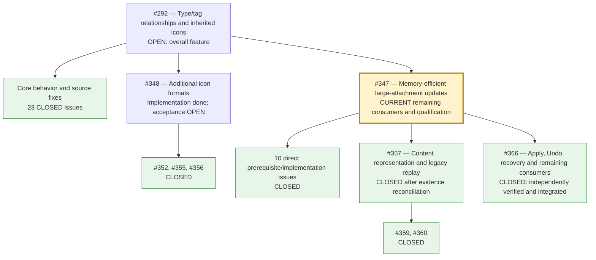

# GitHub issue overview

Snapshot last verified against live GitHub on **2026-11-12**. This is a saved overview, not a continuously updated board.

**Current continuation, 2026-11-12:** implementation follow-ups are integrated through `26d884b` on `codex/r292-type-tag-support`. The latest complete maintained run passed all **2,716 tests and all four checks in 852.60 seconds**, but its **76.02% production branch coverage falls short of 80%**. The subsequent native-read guard refactor passed 59 committed author tests, 14 fresh verifier tests, all four checks and a native status/preservation probe. Complete current-candidate coverage, assembled resource/scaling, actual-source/native acceptance and delivery remain. Monitor weekly usage and pause at **40% remaining or lower**.

## Overall position

There are **8 open issues repository-wide** after the documented #357 and #366 closeouts:

- **3 belong to the current #292 effort:** the overall #292 parent and its #347 large-update and #348 icon acceptance tracks. Current follow-up work is under **#347**.
- **5 belong to other work or historical bookkeeping.**
- The complete #292 issue tree contains **40 closed issues and 3 open issues**. This is an issue count, not an estimate of remaining effort.

“Closed” means an internal task was accepted and integrated into the feature branch. It does not necessarily mean released to main.

The earlier description of icon implementation as still outstanding was inaccurate: **#348's implementation children are closed; final qualification and delivery remain open.**

## Relationships

## Three open issues in the current effort

| Issue | Purpose | Actual progress and remaining work |
|---|---|---|
| [#292](https://github.com/FuzzyUn1c0rn/brz2obsidian/issues/292) | Overall type/tag relationships and inherited-icons feature | Core milestones M1–M4 accepted. Actual-source/native acceptance, final regression/review, user verdict and delivery remain. |
| [#347](https://github.com/FuzzyUn1c0rn/brz2obsidian/issues/347) | Make large-attachment updates practical in memory | #366, CLI status, Windows verification transport, orphan-history refusal and duplicate native-read guard removal are implemented, independently verified and integrated. Latest complete maintained tests/checks pass; the 80% branch gate, assembled resource/scaling and real-source qualification remain. |
| [#348](https://github.com/FuzzyUn1c0rn/brz2obsidian/issues/348) | Bounded ICO/DIB/BMP icon support | Implementation and default library/CLI/Windows wiring complete; all three children closed. Broad regression, actual API/BRZ parity, native/user acceptance and delivery remain. |

## Forty closed issues

| Completed area | Closed issues |
|---|---|
| Core type/tag admission, category rendering, BRZ update compatibility and warning correction | [#324](https://github.com/FuzzyUn1c0rn/brz2obsidian/issues/324), [#325](https://github.com/FuzzyUn1c0rn/brz2obsidian/issues/325), [#326](https://github.com/FuzzyUn1c0rn/brz2obsidian/issues/326), [#329](https://github.com/FuzzyUn1c0rn/brz2obsidian/issues/329) |
| Additional source/attachment handling: YouTube, thought links, capture limits, Markdown literals, missing TXT/images and internal files | [#327](https://github.com/FuzzyUn1c0rn/brz2obsidian/issues/327), [#330](https://github.com/FuzzyUn1c0rn/brz2obsidian/issues/330), [#333](https://github.com/FuzzyUn1c0rn/brz2obsidian/issues/333), [#334](https://github.com/FuzzyUn1c0rn/brz2obsidian/issues/334), [#335](https://github.com/FuzzyUn1c0rn/brz2obsidian/issues/335), [#336](https://github.com/FuzzyUn1c0rn/brz2obsidian/issues/336), [#338](https://github.com/FuzzyUn1c0rn/brz2obsidian/issues/338) |
| Source/output checking, replay qualification and verification-performance corrections | [#328](https://github.com/FuzzyUn1c0rn/brz2obsidian/issues/328), [#331](https://github.com/FuzzyUn1c0rn/brz2obsidian/issues/331), [#332](https://github.com/FuzzyUn1c0rn/brz2obsidian/issues/332), [#337](https://github.com/FuzzyUn1c0rn/brz2obsidian/issues/337), [#339](https://github.com/FuzzyUn1c0rn/brz2obsidian/issues/339), [#340](https://github.com/FuzzyUn1c0rn/brz2obsidian/issues/340), [#341](https://github.com/FuzzyUn1c0rn/brz2obsidian/issues/341), [#342](https://github.com/FuzzyUn1c0rn/brz2obsidian/issues/342), [#343](https://github.com/FuzzyUn1c0rn/brz2obsidian/issues/343) |
| Review guidance, attachment offers and documentation corrections | [#344](https://github.com/FuzzyUn1c0rn/brz2obsidian/issues/344), [#345](https://github.com/FuzzyUn1c0rn/brz2obsidian/issues/345), [#346](https://github.com/FuzzyUn1c0rn/brz2obsidian/issues/346) |
| Bounded content acquisition, comparison, serialization and legacy replay, including reconciled parent | [#349](https://github.com/FuzzyUn1c0rn/brz2obsidian/issues/349), [#350](https://github.com/FuzzyUn1c0rn/brz2obsidian/issues/350), [#354](https://github.com/FuzzyUn1c0rn/brz2obsidian/issues/354), [#357](https://github.com/FuzzyUn1c0rn/brz2obsidian/issues/357), [#359](https://github.com/FuzzyUn1c0rn/brz2obsidian/issues/359), [#360](https://github.com/FuzzyUn1c0rn/brz2obsidian/issues/360) |
| Resource-observation and small resource-proof prerequisites | [#351](https://github.com/FuzzyUn1c0rn/brz2obsidian/issues/351), [#353](https://github.com/FuzzyUn1c0rn/brz2obsidian/issues/353), [#358](https://github.com/FuzzyUn1c0rn/brz2obsidian/issues/358) |
| Cold history inspection, default preparation/choices/Save, onboarding and saved-review restoration | [#361](https://github.com/FuzzyUn1c0rn/brz2obsidian/issues/361), [#362](https://github.com/FuzzyUn1c0rn/brz2obsidian/issues/362), [#363](https://github.com/FuzzyUn1c0rn/brz2obsidian/issues/363), [#364](https://github.com/FuzzyUn1c0rn/brz2obsidian/issues/364) |
| Owned publication, operation details, Undo/recovery, terminal cleanup and retained ownership/repair consumers | [#366](https://github.com/FuzzyUn1c0rn/brz2obsidian/issues/366) |
| Independent icon expectations, ICO/DIB/BMP admission and default profile wiring | [#352](https://github.com/FuzzyUn1c0rn/brz2obsidian/issues/352), [#355](https://github.com/FuzzyUn1c0rn/brz2obsidian/issues/355), [#356](https://github.com/FuzzyUn1c0rn/brz2obsidian/issues/356) |

## Five other open issues: outside the current #292 implementation

| Issue | Relationship and status |
|---|---|
| [#254](https://github.com/FuzzyUn1c0rn/brz2obsidian/issues/254) | Broader editable-vault roadmap. Stage-one updates delivered through [#255 / PR #323](https://github.com/FuzzyUn1c0rn/brz2obsidian/pull/323). Remains open for later import functionality. |
| [#259](https://github.com/FuzzyUn1c0rn/brz2obsidian/issues/259) | Future stage-two feature: importing a different Brain and mapping categories/tags. Specified, not dispatched for implementation. |
| [#258](https://github.com/FuzzyUn1c0rn/brz2obsidian/issues/258) | Future stage-two shared operations and Windows/CLI review. Depends on #259; not current work. |
| [#203](https://github.com/FuzzyUn1c0rn/brz2obsidian/issues/203) | Development-workflow guidance delivered through merged [PR #204](https://github.com/FuzzyUn1c0rn/brz2obsidian/pull/204), while the issue remains open. Bookkeeping needs reconciliation. |
| [#112](https://github.com/FuzzyUn1c0rn/brz2obsidian/issues/112) | Historical check-runner subtask. Parent #111 closed, but this issue remains open without its own completion record. Status needs reconciliation; not scheduled feature work. |

## Remaining route for this effort

1. Bring the maintained selection up to date for the owned public consumers and meet the 80% branch/under-900-second gate; finish #347 assembled resource/scaling qualification. The latest 398-selector run passed its tests/checks but failed the coverage threshold. Reuse existing fixtures and measurement tools for the remaining work.
2. Complete #348 assembled-candidate acceptance. #357 and #366 closeouts are complete.
3. Complete #292 real-source/native checks and user acceptance.
4. Deliver the assembled feature through its final PR and close the remaining parent issues.

Different-Brain imports in #259/#258 are a separate future feature.

## Preserved implementation state at the pause

- Feature root: `codex/r292-type-tag-support`, checkout `C:/Users/stefa/projects/brz2obsidian`, commit `740e3a9d7caa8cd683f5198a1fa3c4065599bf4b`.
- Author: `codex/r347-owned-publication`, checkout `C:/Users/stefa/.codex/worktrees/r359-family-codec/brz2obsidian`, checkpoint `6ad06beee63f511b69df8f747c89f57bd3275e48`, plus five uncommitted restored-Undo files.
- Latest whole-leaf source verdict: PASS for immutable candidate003. Runtime qualification remains incomplete.
- Last focused run logged 18 passed and two Windows child-process exits with status `0xC0000142`; it was also cancelled at the usage threshold. The restored-Undo flow reached its final fresh-process status check; the other case failed during Git initialization. Their cause requires a clean rerun before classifying a product defect.
- The extra Inline terminal-history control fails identically on clean accepted base; its evidence is preserved as a pre-existing failure.
- SQLite/generic accounting work remains parked.
- Detailed pause record: [current-state-resume113-paused.json](tmp/r347-owned-publication-20261110/current-state-resume113-paused.json).

## Progress since the snapshot — 2026-11-12

- Work resumed with the new pause threshold of 40% weekly remaining.
- The unchanged Undo rerun passed all 20 selected tests, lint, formatting, dependency checks, partial coverage reporting and receipt validation in 390.74 seconds. The earlier child-process exits did not reproduce.
- The restored-Undo correction is committed as `150316d6519e2f3ba3793baa268b09686515f628` on `codex/r347-owned-publication`.
- Post-commit completion checks passed all 19 selected tests and all four check types in 214.72 seconds. The author checkout is clean.
- Distinct independent verification passed 17/17 selected tests and all four checks on clean commit150316d, including the large owning publication/details/cleanup/repeat journey. Its total1,202.04 seconds is extended focused evidence, not ordinary-bundle qualification.
- #366 was merged without conflict into the feature root as `72428d4e11e32a6592d71c90473a3fbd75778e25`. Fresh combined-tree16-case/all-four checks passed; candidate, verification and integration publication plus separate standalone validation all passed. [Completion and limits](https://github.com/FuzzyUn1c0rn/brz2obsidian/issues/366#issuecomment-6818425703) record internal closure. Parent acceptance/delivery remains open.
- #357 was closed after reconciling C1–C8 against actual accepted checks, independent handoffs and feature-root integrations. [Closeout evidence and limits](https://github.com/FuzzyUn1c0rn/brz2obsidian/issues/357#issuecomment-6818230280) preserve the engineering-estimate amendment and original 44-selector scope. This does not complete #347 resource/native acceptance.
- CLI status/Windows transport repairs were integrated as `a7e5833`; regression-fixture corrections and genuine orphan-history onboarding refusal followed as `c13d32d`, with 238 focused and 30 independent tests passing.
- The subsequent complete maintained run at `d59e103` passed 2,716 tests, lint, formatting and dependency checks; receipt validation passed. Total elapsed was 852.60 seconds. Its 84.61% line coverage and 76.02% branch coverage are distinct: the required 80% branch gate remains unmet.
- `26d884b` removes duplicate checks within an owned read while preserving complete semantic-byte verification and native checks at actual read/exit boundaries. Its final committed 59-test scope and fresh independent 14-test scope passed all four checks and receipt validation. A separate native status probe verified retained Git identities and preserved all 147 vault files. Candidate, verification and local integration records passed their separate validators.
- The attempted 257-byte variant of a full publication/terminal-cleanup journey timed out; its source, partial evidence and fixture are preserved outside the maintained selection. The original 16 MiB owning test is unchanged. The guard refactor's initial staging-capability regression was caught by existing tests and repaired before acceptance.
- Current work reuses the existing tiny native Undo fixture to qualify the owned History review path and prepares an assembled 16 MiB resource baseline. Full scaling, reported-source/API/BRZ/native UI, final user acceptance and delivery are still unqualified.

